# Testes Caixa Cinza em API de Autenticação (Supabase + Postman)

| | |
|---|---|
| **Aluno** | Vinicius Paes Lima |
| **RA** | 2520215 |
| **Curso** | CST em Análise e Desenvolvimento de Sistemas - FACENS |
| **Data de execução** | 04/11/2026 |

---

# Introdução

Este repositório reúne a atividade de testes caixa cinza na API de autenticação do Supabase. Criei um projeto no Supabase com login por e-mail e senha, cadastrei um usuário de teste e usei o Postman Desktop para mandar requisições ao endpoint de login. Testei o caso de sucesso e quatro casos de erro.

O teste é caixa cinza porque eu não tenho acesso ao código do serviço de autenticação, mas conheço parte da estrutura: o endpoint, os headers obrigatórios, o formato do body e os códigos de resposta que a API devolve. Com isso dá para montar entradas específicas e conferir se a resposta bate com o esperado.

Estrutura do repositório:

```
/README.md
/postman/    collection e environment exportados do Postman
/prints/     evidências tiradas durante a atividade
/planilha/   planilha de registro dos testes (.xlsx)
```

# Objetivo da Atividade

O objetivo é aplicar testes caixa cinza em uma API de autenticação usando ferramentas de mercado. Na prática, isso significa:

- configurar um ambiente de autenticação no Supabase;
- criar um usuário para os testes;
- entender como funciona a requisição HTTP de login (método, headers, body e respostas);
- usar o Postman para executar e validar os testes;
- conferir status HTTP, JSON de resposta, mensagens de erro e o access token;
- documentar todo o processo neste README e na planilha.

# Configuração do Supabase

**Como o projeto foi criado**

Com a conta do Supabase já criada, entrei na organização *Vinicius Paes Lima* (plano Free) e criei um projeto novo chamado `caixa-cinza-vinicius-2520215`. Coloquei meu nome e RA no nome do projeto para identificar o ambiente. A região ficou em Americas (us-east-1) e a senha do banco foi gerada pelo próprio Supabase. Depois que o projeto ficou com status *Healthy*, a URL da API apareceu na tela inicial:

```
https://aafxkrtmsfqfrogtcwey.supabase.co
```

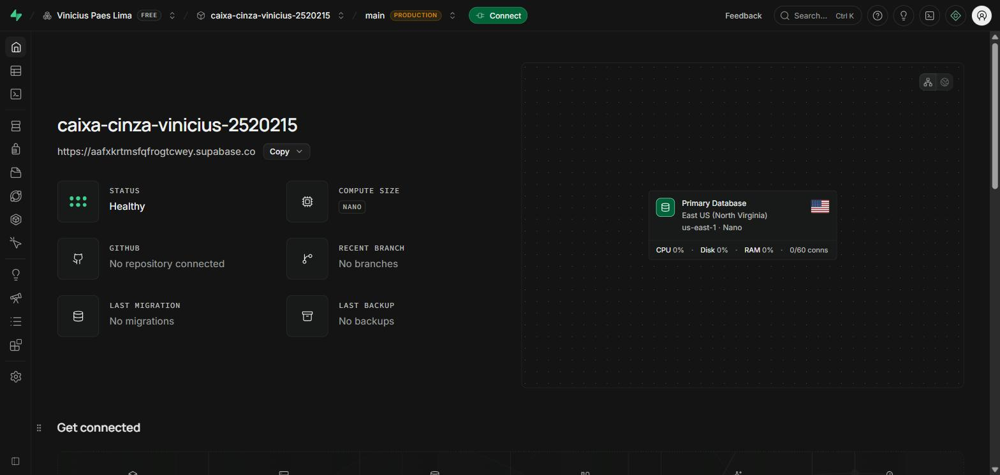

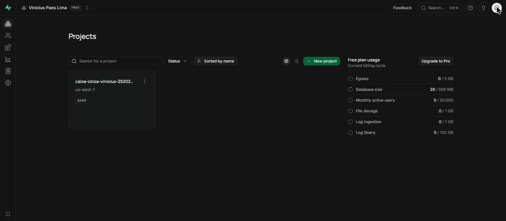

**Tipo de autenticação utilizada**

Usei a autenticação por **e-mail e senha** (provider *Email*), que já vem habilitada por padrão. Conferi em *Authentication → Sign In / Providers* que ela estava como *Enabled*.

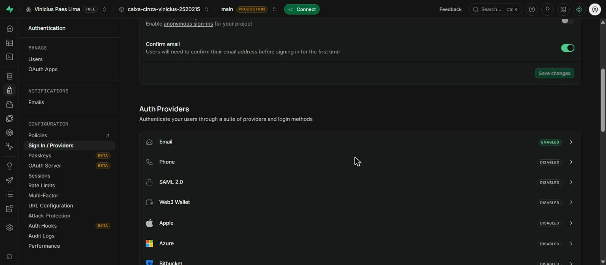

**Como o usuário foi criado**

Em *Authentication → Users → Add user → Create new user*, cadastrei o usuário `vinicius.2520215@teste.com` com uma senha e marquei a opção **Auto confirm user**. Assim ele já fica confirmado e não precisa validar e-mail, o que permite testar o login direto.

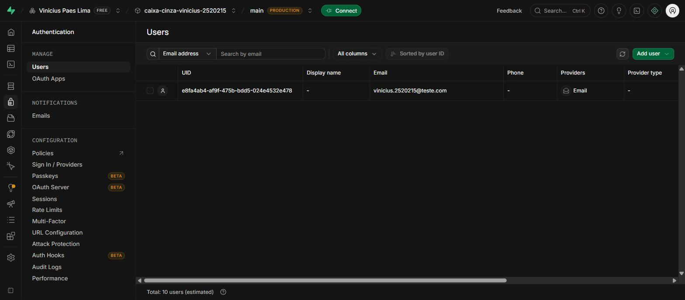

**Credenciais da API**

Em *Settings → API Keys* peguei a chave **anon public**, que é a chave pública usada pelo cliente nas requisições. A chave *service_role* não foi usada e continua oculta, porque ela ignora as regras de segurança e não pode ser exposta.

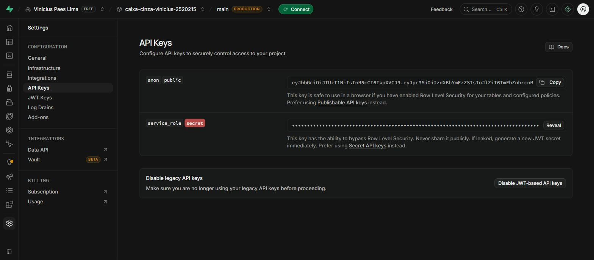

| Informação | Valor |
|---|---|
| API URL | `https://aafxkrtmsfqfrogtcwey.supabase.co` |
| API KEY | chave `anon public` do projeto |
| Usuário de teste | `vinicius.2520215@teste.com` |
| Senha | guardada só no environment do Postman (tipo *secret*) |

**Objetivo da configuração**

A ideia foi ter um serviço de autenticação real e funcionando, com um usuário válido conhecido. Assim os testes do Postman batem num backend de verdade e dá para comparar o comportamento com usuário certo, senha errada, usuário que não existe e dados inválidos.

# Configuração do Postman

**Como o Workspace foi criado**

No Postman Desktop, abri o menu de workspaces, cliquei em *Create* e criei o workspace **"Caixa Cinza - Vinicius 2520215"** do tipo *Blank workspace*. Tudo da atividade ficou separado dentro dele.

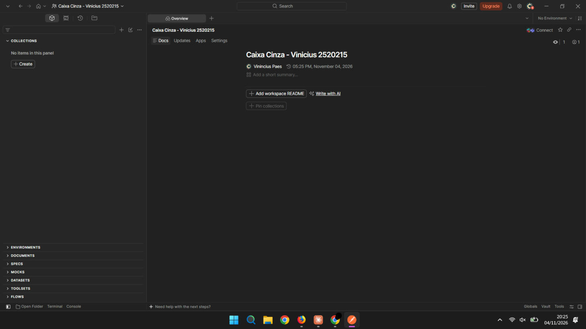

**Como o Environment foi configurado**

Criei o environment **"Supabase - Caixa Cinza"** e deixei ele ativo no seletor do canto superior direito. Ele tem quatro variáveis:

| Variável | Descrição |
|---|---|
| `base_url` | URL da API do Supabase |
| `api_key` | API KEY (anon public) |
| `email` | Usuário criado |
| `password` | Senha criada (tipo *secret*, aparece mascarada) |

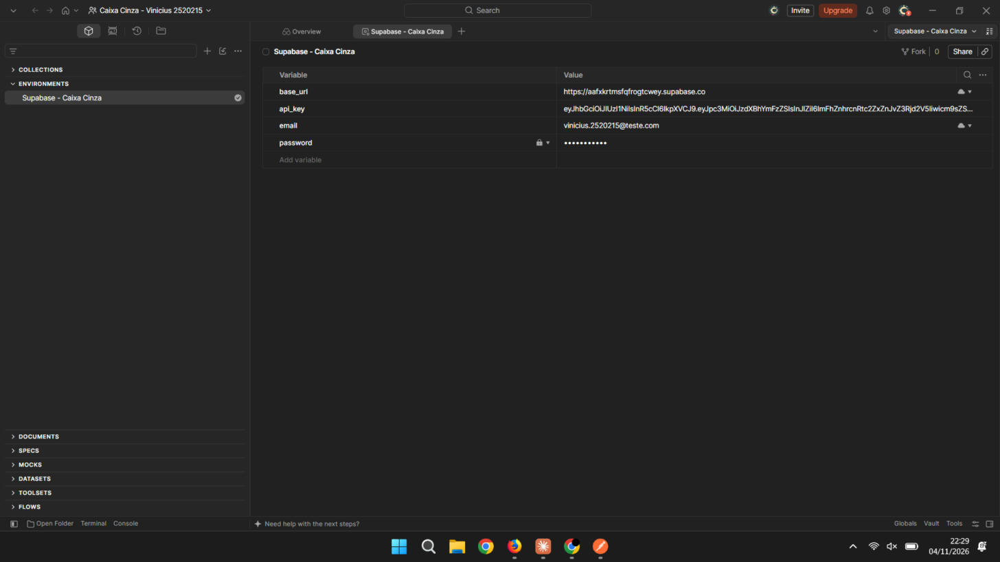

**Finalidade das variáveis**

As variáveis evitam repetir URL, chave e credenciais em cada requisição. Se algo mudar (outro projeto, outra chave ou outra senha), basta trocar no environment que todas as requisições passam a usar o valor novo. Outra vantagem é que a senha não fica escrita no body das requisições, só a referência `{{password}}`.

**Como o Postman foi usado nos testes**

Criei a collection **"Caixa Cinza - Autenticacao Supabase"** com uma requisição para cada cenário (CT01 a CT05). Cada requisição tem um script na aba *Scripts → Post-response* que valida a resposta automaticamente com `pm.test` (status HTTP, presença ou ausência do token, mensagem de erro e `error_code`). Rodei cada requisição individualmente e, no fim, rodei a collection inteira pelo *Collection Runner*.

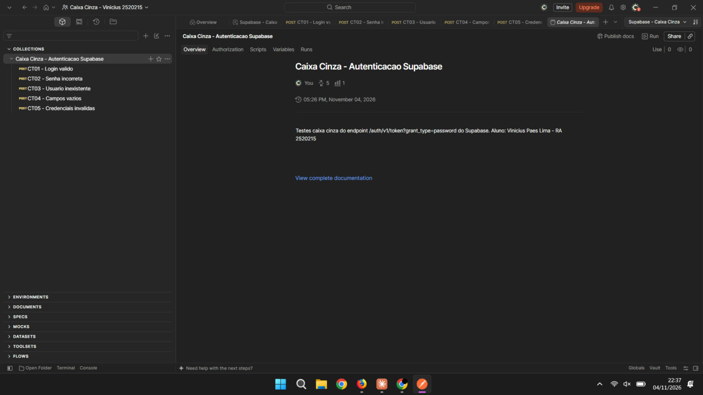

Os arquivos exportados estão na pasta `/postman`. No environment exportado, `api_key` e `password` estão vazios de propósito, para não publicar credenciais no GitHub.

# Configuração das Requisições

**Endpoint utilizado**

```
{{base_url}}/auth/v1/token?grant_type=password
```

**Método HTTP:** `POST`

O parâmetro `grant_type=password` diz para o Supabase que o login vai ser feito com e-mail e senha.

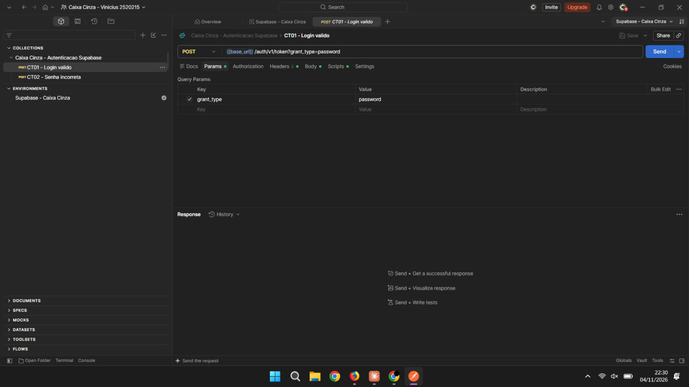

**Headers utilizados**

| Header | Valor |
|---|---|
| apikey | XXXXX |
| Authorization | Bearer XXXXX |
| Content-Type | application/json |

No Postman, o `XXXXX` é a variável `{{api_key}}`. O `apikey` identifica o projeto no gateway do Supabase, o `Authorization` manda a mesma chave como Bearer e o `Content-Type` avisa que o body está em JSON.

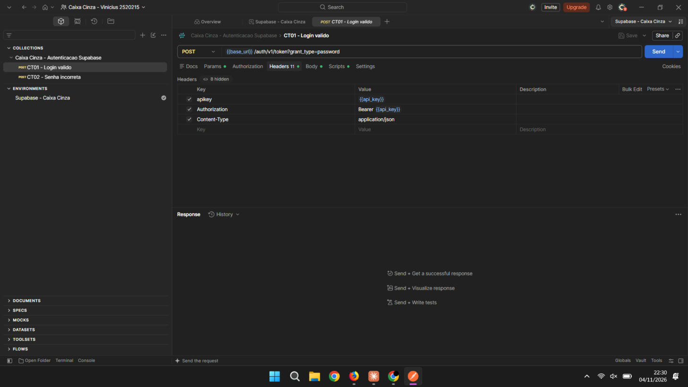

**Body JSON utilizado**

Exemplo do formato:

```json
{
  "email": "usuario@email.com",
  "password": "123456"
}
```

No CT01 o body usa as variáveis do environment:

```json
{
  "email": "{{email}}",
  "password": "{{password}}"
}
```

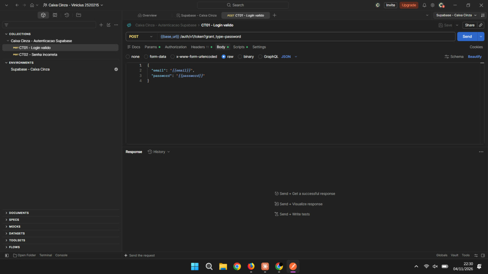

**Finalidade da requisição**

A requisição autentica o usuário. Se e-mail e senha estiverem certos, a API devolve um `access_token` (JWT) que o cliente usaria nas próximas chamadas protegidas, além de `refresh_token`, tempo de expiração e os dados do usuário. Se algo estiver errado, ela devolve um erro com código e mensagem.

# Execução dos Testes

Os cinco cenários obrigatórios foram executados no Postman Desktop em 04/11/2026. Todas as requisições usam o mesmo endpoint, os mesmos headers e o mesmo método. O que muda entre elas é só o body.

**Tabela de Cenários**

| Cenário | Entrada Utilizada | Resultado Esperado | Resultado Obtido | Status |
|---|---|---|---|---|
| Login válido | `vinicius.2520215@teste.com` + senha correta | Status 200 + access token | 200 OK, `access_token` JWT, `token_type: bearer`, `expires_in: 3600` | OK |
| Senha incorreta | `vinicius.2520215@teste.com` + `senhaErrada123` | Erro de autenticação | 400, `invalid_credentials`, "Invalid login credentials" | OK |
| Usuário inexistente | `naoexiste.2520215@teste.com` + senha válida | Acesso negado | 400, `invalid_credentials`, "Invalid login credentials" | OK |
| Campos vazios | `email: ""` e `password: ""` | Erro de validação | 400, `validation_failed`, "missing email or phone" | OK |
| Credenciais inválidas | `usuario_invalido` (sem formato de e-mail) + `123` | Mensagem de erro | 400, `invalid_credentials`, "Invalid login credentials" | OK |

**CT01 - Login válido**

Retornou **200 OK** em 760 ms com `access_token`, `token_type: "bearer"`, `expires_in: 3600`, `refresh_token` e o objeto `user` com o e-mail do usuário de teste. Passou nas 5 validações.

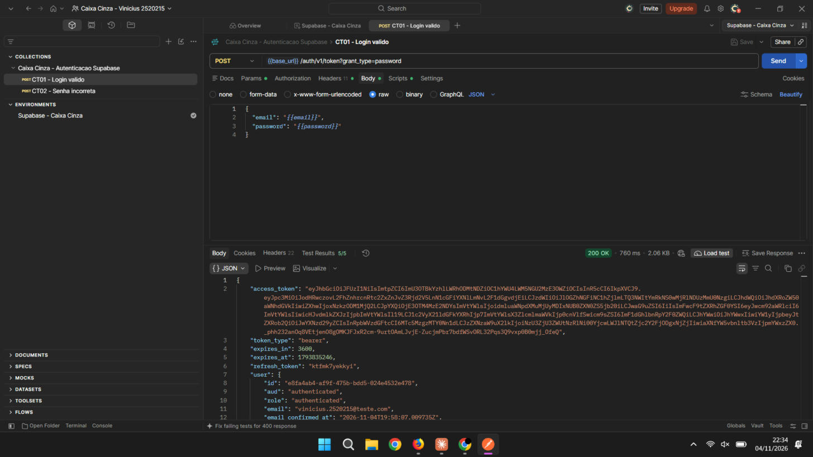

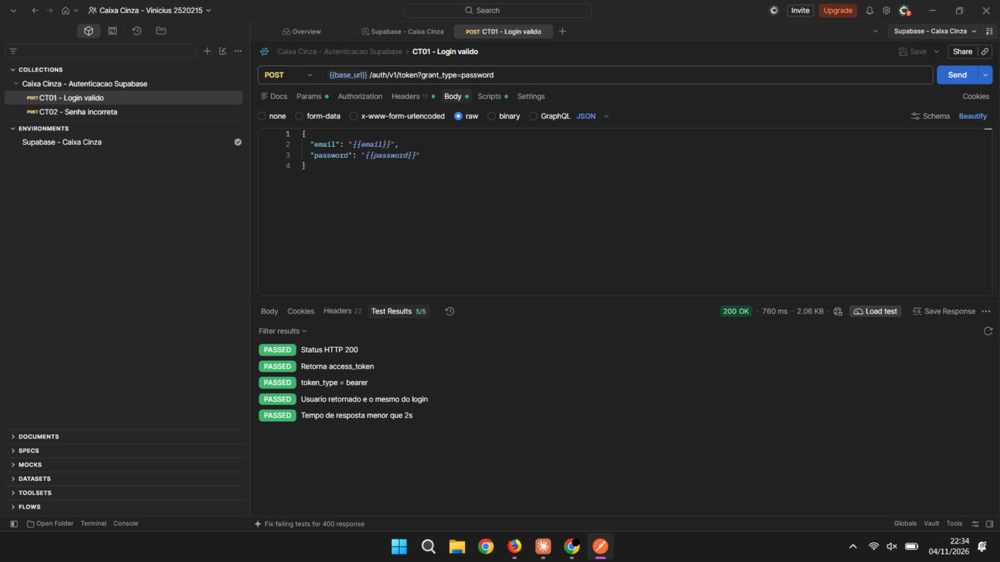

**CT02 - Senha incorreta**

Retornou **400 Bad Request** com `error_code: "invalid_credentials"` e `msg: "Invalid login credentials"`. Nenhum token foi gerado. Passou nas 4 validações.

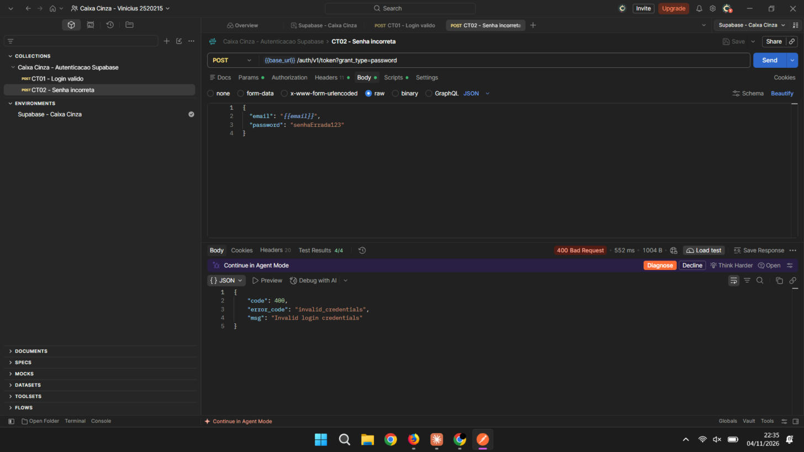

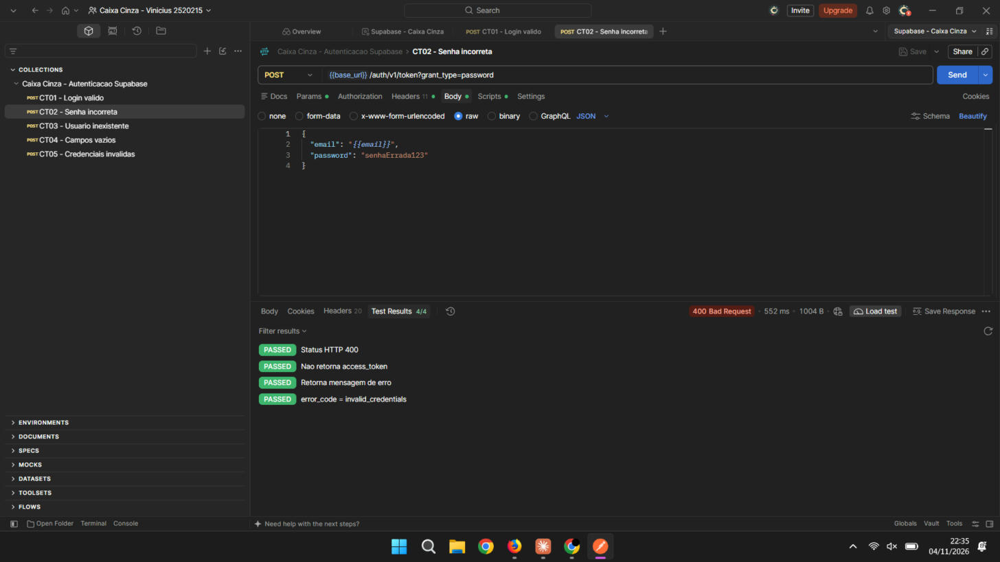

**CT03 - Usuário inexistente**

Retornou **400** com a mesma resposta do CT02. Passou nas 4 validações.

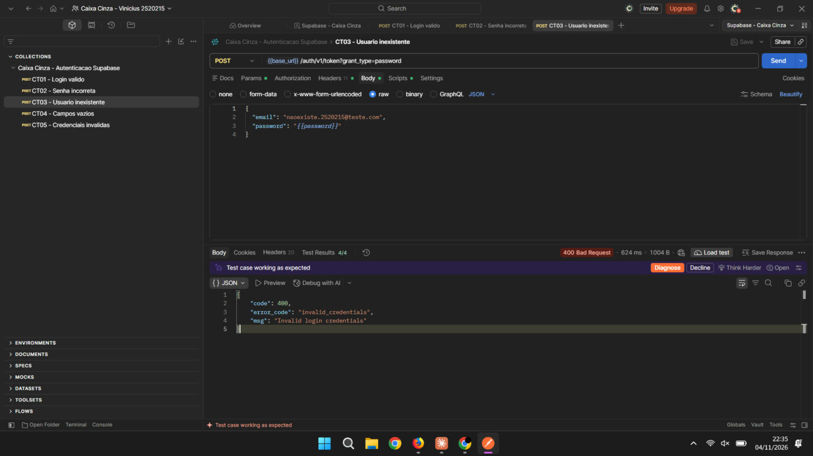

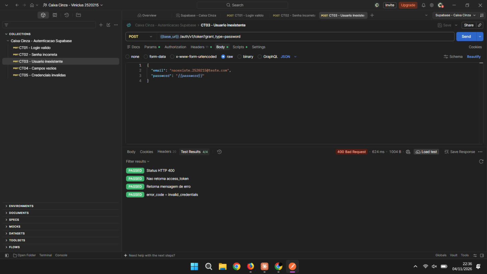

**CT04 - Campos vazios**

Retornou **400** com `error_code: "validation_failed"` e `msg: "missing email or phone"`. Aqui o erro é de validação e não de credencial, como esperado. Passou nas 3 validações.

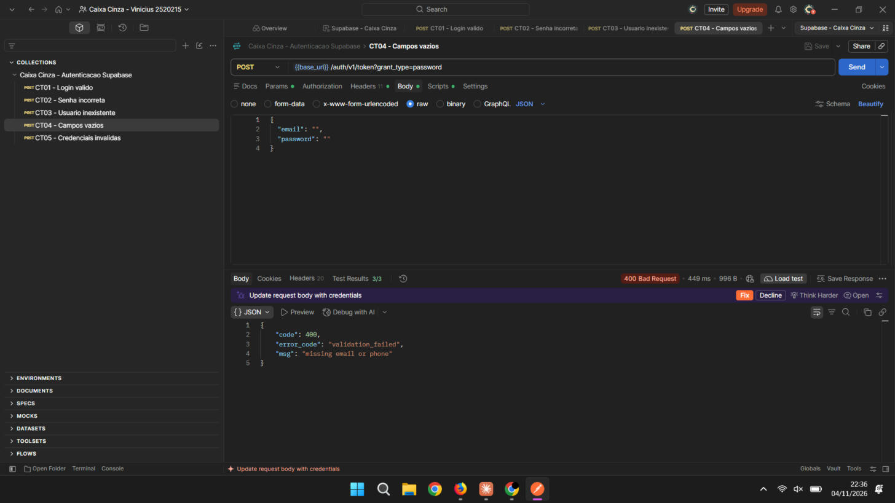

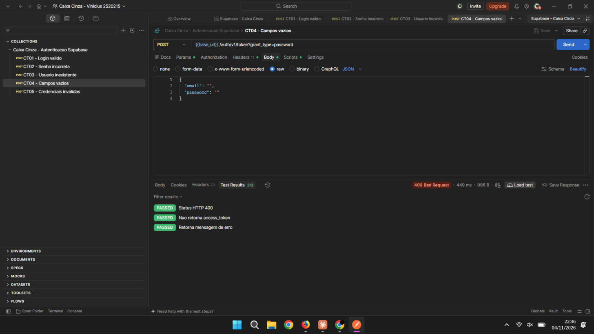

**CT05 - Credenciais inválidas**

Mandei um e-mail sem formato válido (`usuario_invalido`) e uma senha curta (`123`). Retornou **400** com `invalid_credentials`. Passou nas 3 validações.

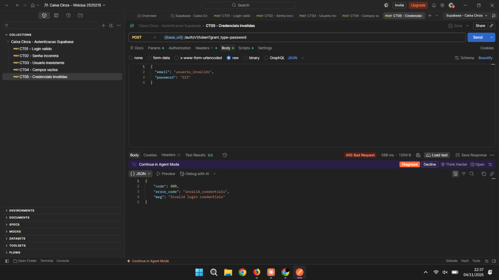

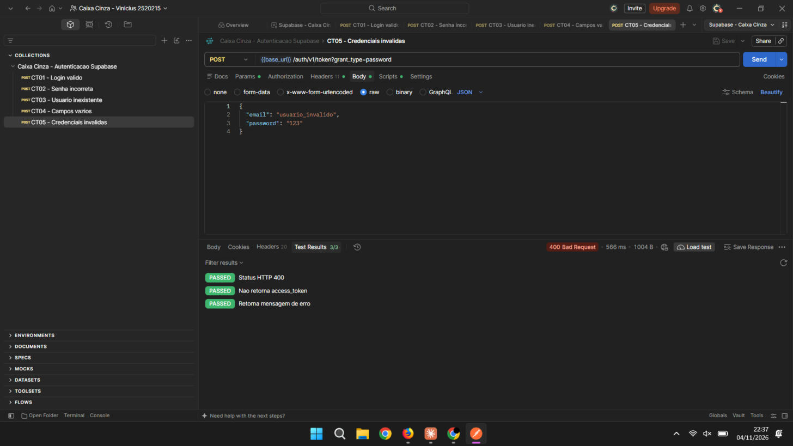

**Execução completa pelo Collection Runner**

Depois rodei a collection inteira de uma vez: **19 asserções, 19 aprovadas, 0 falhas, 0 erros**, duração de 8,3 s e tempo médio de resposta de 674 ms.

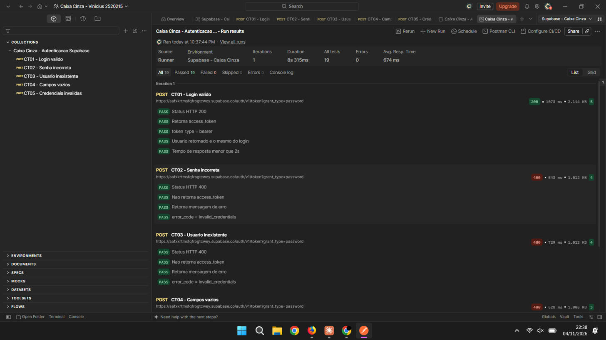

**Erros encontrados durante a execução**

Nas duas primeiras vezes que rodei o CT01, o retorno foi `400 - Invalid login credentials`. O problema não era a API: a senha que estava no environment do Postman não era igual à senha cadastrada no usuário. Como a resposta chegou do serviço de autenticação com código e mensagem certinhos, deu para ver que a URL e a API key estavam corretas e que o problema estava só na senha. Depois de corrigir a variável `password`, o CT01 passou.

# Registro dos Testes

**Como os testes foram registrados**

Registrei cada cenário na planilha `planilha/planilha-de-testes.xlsx` com os campos pedidos: ID do teste, cenário, entrada, resultado esperado, resultado obtido, status e observações. Os resultados obtidos foram copiados das respostas reais do Postman (status, tempo, `error_code` e mensagem). No final da planilha tem um resumo com fórmulas que contam os cenários com sucesso e com falha e calculam a taxa de sucesso.

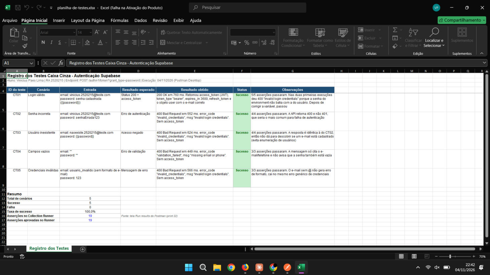

Exemplo de registro:

| ID do teste | Cenário | Entrada | Resultado esperado | Resultado obtido | Status | Observações |
|---|---|---|---|---|---|---|
| CT02 | Senha incorreta | `vinicius.2520215@teste.com` / `senhaErrada123` | Erro de autenticação | 400, `invalid_credentials`, "Invalid login credentials", sem token | Sucesso | A API retorna 400 e não 401 |
| CT04 | Campos vazios | `""` / `""` | Erro de validação | 400, `validation_failed`, "missing email or phone" | Sucesso | A mensagem não cita a senha vazia |

**Importância da documentação dos testes**

Com o registro, qualquer pessoa consegue repetir o teste com as mesmas entradas e comparar o resultado. Também fica um histórico: se a API mudar o comportamento no futuro (outro status ou outra mensagem), dá para perceber a diferença comparando com a planilha. E a planilha mostra de forma rápida o que foi coberto e o que passou ou falhou, sem precisar abrir o Postman.

**Falhas identificadas**

Nenhum cenário falhou: todos os resultados obtidos bateram com os esperados. Mesmo assim, anotei alguns pontos de atenção:

1. **Status 400 em vez de 401.** Para senha errada e usuário inexistente, o Supabase devolve `400 Bad Request`. Pela convenção REST, falha de autenticação costuma ser `401 Unauthorized`. Não chega a ser um erro, mas quem consome a API precisa tratar pelo `error_code` e não só pelo status.
2. **Mensagem incompleta nos campos vazios.** Com e-mail e senha vazios, a mensagem é só "missing email or phone". Não avisa que a senha também está faltando.
3. **Sem validação de formato de e-mail.** No CT05, um e-mail sem `@` não gerou erro de formato. Caiu no mesmo erro genérico de credenciais inválidas.
4. **Falha de configuração do testador.** As duas primeiras execuções do CT01 falharam por causa da senha errada no environment (descrito em *Execução dos Testes*).

# Resultados Obtidos

| Métrica | Resultado |
|---|---|
| Cenários executados | 5 de 5 |
| Cenários com sucesso | 5 |
| Cenários com falha | 0 |
| Asserções no Collection Runner | 19 aprovadas de 19 |
| Tempo médio de resposta (Runner) | 674 ms |
| Access token no login válido | Sim (JWT, expira em 3600 s) |

Resumo do que deu para observar:

- O login válido devolveu o token e os dados do usuário corretamente.
- Nenhum cenário de erro gerou token, ou seja, a API não deixou passar acesso indevido.
- Senha errada e usuário inexistente têm a **mesma resposta**. Isso é bom para segurança, porque quem tenta invadir não consegue descobrir quais e-mails estão cadastrados (enumeração de usuários).
- Campos vazios recebem um erro diferente (`validation_failed`), separando erro de validação de erro de credencial.
- Todas as respostas vieram abaixo de 2 segundos.

# Conclusão

**Os testes foram executados corretamente?** Sim. Os cinco cenários obrigatórios foram executados no Postman Desktop, primeiro um por um e depois todos juntos pelo Collection Runner, com validações automáticas em cada requisição.

**A autenticação funcionou?** Sim. O usuário válido conseguiu logar e recebeu o access token, e todas as tentativas inválidas foram bloqueadas com mensagem de erro.

**Dificuldades encontradas.** A principal foi o CT01 falhando no começo por causa da senha diferente no environment. Levou um tempo para entender que o problema não era a API. A dica estava na própria resposta: como ela veio no formato padrão do Supabase, a conexão e a chave estavam certas. Também tive um pouco de instabilidade no painel do Supabase (algumas telas demoraram para carregar e a sessão chegou a expirar uma vez).

**Falhas identificadas.** Nenhum defeito funcional. Os pontos de atenção foram o uso de 400 em vez de 401, a mensagem incompleta para campos vazios e a falta de validação de formato do e-mail.

**Melhorias que poderiam ser implementadas.**

- Validar o formato do e-mail e devolver uma mensagem própria para isso.
- Deixar a mensagem de campos vazios mais clara, avisando quais campos estão faltando.
- Testar o limite de tentativas de login (rate limit), para ver se a API bloqueia ataques de força bruta.
- Incluir testes com o `access_token` gerado em um endpoint protegido e com token expirado.
- Rodar a collection pelo Postman CLI (Newman) em uma pipeline de CI, para os testes rodarem a cada mudança.

**Importância dos testes caixa cinza em APIs.** O teste caixa cinza fica no meio do caminho: não precisa do código-fonte, mas usa o conhecimento da estrutura (endpoint, headers, formato do body e códigos de erro) para escolher entradas melhores do que um teste totalmente às cegas. Em autenticação isso pesa bastante, porque não basta ver que o login funciona. É preciso garantir que entradas erradas sejam bloqueadas, que nenhum token vaze e que as mensagens não entreguem informação demais. Foi esse tipo de verificação que deu para fazer aqui com o Postman.
